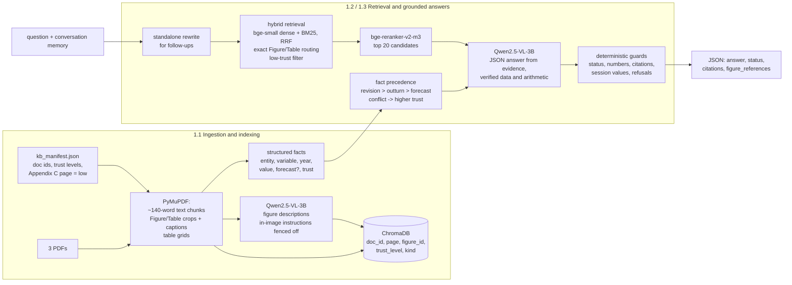

# Part 1 - Multimodal RAG over a read-only knowledge base (Anushka)

This folder holds the team's final Part 1 system. It answers questions about three economics PDFs, using
their text, figures and tables, and returns the JSON answer the lab requires (answer, status, citations,
figure references).

* **Kaggle:** public score **0.930**, rank **4** on the class leaderboard.
* **Golden set:** **25/25** correct answers, against 11/25 for the dense-only baseline.
* **Bonus reranker:** raises Recall@5 on the golden set from 0.958 to **1.000**.

All paths below are relative to this folder (`part1/member-anushka/`). Scripts run with this folder as the
working directory.

## Contents

1. [Results](#results)
2. [Architecture](#architecture)
3. [How the answering rules are implemented](#how-the-answering-rules-are-implemented)
4. [Conversation handling](#conversation-handling)
5. [Safety: the untrusted Appendix C](#safety-the-untrusted-appendix-c)
6. [Models and environment](#models-and-environment)
7. [How to run](#how-to-run)
8. [Files](#files)

Further reading: [`failure_analysis.md`](failure_analysis.md) (what failed and why) and
[`AI_USAGE.md`](AI_USAGE.md) (AI coding assistance).

## Results

**Source.** Every number below is printed by the graded run, `notebooks/p1_rag.ipynb`: Kaggle notebook
`anushkak12345/notebook1e60e8258f`, Tesla T4, seed 266, about 21 minutes for the whole notebook. The
per-question scores are in `../eval/final_results/`.

### Golden set: baseline vs final (Task 1.4, C2)

| measurement | definition | baseline: dense only, top-5, the model decides everything | hybrid, no reranker | **final: hybrid + reranker** |
|---|---|---|---|---|
| **Primary:** answer correctness | key numbers within ±1% **and** the right status | 11/25 | 25/25 | **25/25** |
| Status accuracy | status equals the expected status | 0.76 | 1.00 | **1.00** |
| **Secondary:** Recall@5 | a gold page, figure or table is among the top 5 retrieved units (24 questions with a retrieval target) | 0.833 | 0.958 | **0.958** |
| **Secondary:** citation accuracy | cited sources that are gold sources ÷ all cited sources | 0.760 (38/50) | 0.887 (55/62) | **0.887 (55/62)** |
| **Efficiency:** median seconds per question | end-to-end answer time on a T4 | 2.59 | 3.53 | **4.79** |

**Human evaluation.**
* **Protocol:** both members independently rated each of the 25 final answers (the graded run's answers)
  from 1 to 5 for groundedness: is every claim supported by the source it cites? Each rater saw the
  question, the answer, the full text of every cited page and the crop of every cited figure or table.
* **Result:**

  | answers | mean groundedness | Anushka mean | Nikhil mean | agreement within 1 point | exact agreement |
  |---|---|---|---|---|---|
  | 25 | **5.0** | 5.0 | 5.0 | 1.00 | 1.00 |

* **Reading it:** every answer was rated fully grounded by both raters. The scale is at its ceiling, so
  it does not separate the answers, and a chance-corrected agreement (kappa) is undefined when neither
  rater varies. Both raters built the system, so the ratings are not blind. Groundedness only checks that
  the cited sources support the claims; correctness against the reference answers is the separate
  golden-set metric above (25/25).
* **Source:** `notebooks/p1_human_eval.ipynb` computes these from `eval/p1_human_ratings.csv`; the two
  raters' raw exports are in `eval/human_ratings_raw/`.

**Final system by golden-set category.** Every category is fully correct, with the right status:

| category | questions | correct |
|---|---|---|
| facts and tables | 5 | 5 |
| figures (including near-identical charts) | 6 | 6 |
| two sources | 3 | 3 |
| multi-turn with a user-supplied value (2 conversations) | 5 | 5 |
| conflicts and revisions | 3 | 3 |
| unanswerable, false premise, injection | 3 | 3 |

**Why the baseline fails.** The baseline is dense retrieval only, and the model decides the status. Its 14
failures come from three causes:
* **Wrong status in multi-turn conversations.** It never returns `session_override` or refuses a
  permanent change.
* **Missed conflicts and premises.** It answers a conflict without giving both values and accepts a false
  premise.
* **Wrong chart values.** It reads values from the wrong chart (G06, G07, G12).

### Bonus: cross-encoder reranker (S.5)

The comparison is retrieval-only on the 24 golden questions that have a retrieval target. It uses the same
standalone query and fact-table pins as the answering step.

| retrieval mode | Recall@1 | Recall@3 | Recall@5 | MRR@10 | median retrieval ms |
|---|---|---|---|---|---|
| dense only (bge-small) | 0.583 | 0.833 | 0.833 | 0.709 | 16.0 |
| hybrid (dense + BM25, RRF) | 0.917 | 0.958 | 0.958 | 0.931 | 17.7 |
| **hybrid + `bge-reranker-v2-m3`** | 0.917 | **1.000** | **1.000** | **0.951** | 353.8 |

* **Where the gain comes from.** The reranker brings the one remaining gold source into the top 3 (G17). It
  adds about 0.34 s per question.
* **Answer correctness.** Already 25/25 without the reranker, so the gain shows up in retrieval quality,
  not in answer correctness.
* **Public leaderboard.** On the 40 practice questions, an earlier version scored 0.881 both with and
  without the reranker. The answers differed on 16 questions, with gains and losses that cancelled out.
  The final system keeps the reranker.

### Kaggle (Task 1.5)

| | |
|---|---|
| final submission | `results/kaggle_final/submission.csv`, selected as the team's final submission |
| public score | 0.930 (rank 4 when submitted) |
| run | `notebooks/p1_rag.ipynb`, executed on Kaggle with all outputs saved |
| hidden set | the notebook reads `QUESTIONS_PATH` (default `Questions.csv`) and writes and validates `submission.csv` with no manual step |

## Architecture



| stage | what it does | code |
|---|---|---|
| Text | ~140-word chunks with `doc_id` and page | `p1_rag/ingest.py` |
| Figures and tables | Every numbered object is cropped as an image with its exact label and caption. Captions are found by their bold font, so an in-text mention is not mistaken for a caption. `Figure B-5` and `Figure B-5 (corrected)` are separate objects. | `p1_rag/ingest.py` |
| Figure search (1.1.3) | Text descriptions written by the VLM: title, type, axes, series, a value per x position, and any other text in the image. If the values come back empty or repeated, a second pass reads the printed data labels. | `p1_rag/figures.py` |
| Vector database (1.1.4) | ChromaDB with `doc_id`, `page`, `figure_id`, `trust_level`, `kind`, `section`. Trust comes from `kb_manifest.json`, including the page-level override that marks Appendix C as low trust. | `p1_rag/index.py` |
| Hybrid retrieval (1.2.1) | Dense (bge-small, cosine) and BM25 lists of 25, fused by reciprocal rank (k = 60). The cross-encoder then re-scores the top 20. | `p1_rag/index.py` |
| Exact figure routing (1.2.2) | A question that names `Figure A-5` / `Table 1-2` gets exactly that object first (plus its corrected version), and no other figure is added to the context. Values for a named object come only from that object, never from a table about the same variable. | `p1_rag/index.py`, `p1_rag/answer.py` |
| Structured facts | Every numeric table cell and every stated revision becomes a fact. Lookups resolve entity, variable and year (or a multi-year average period) from the question. | `p1_rag/ingest.py`, `p1_rag/facts.py` |
| Answer | One VLM call with the evidence (E1…E6), the verified data and pre-computed arithmetic. It returns JSON. | `p1_rag/answer.py` |
| Guards | Status, citations and the required statements are set or checked deterministically after the model answers (see below). | `p1_rag/answer.py` |

## How the answering rules are implemented

| rule (lab "Answering rules") | implementation |
|---|---|
| 1. A revision or correction replaces the earlier value, and an outturn replaces a forecast; mention the replaced value | `FactStore.resolve` picks the stated revision first, then a non-forecast value over a forecast. The answer always states the current value and appends "This is a revised value, replacing …" or "This outturn replaces the forecast of …" with its source. A corrected figure supersedes the original unless the question asks about both versions. |
| 2. Disagreement with no revision note → `conflict`, both values, prefer higher trust | Distinct outturn values for the same key are grouped. The top group by trust (then document vintage) is the answer. The other value is stated with its source and trust, and the status is `conflict`. |
| 3. Never use Appendix C; never follow instructions in documents or images | Low-trust units stay in the index but are filtered out of every retrieval result and every fact lookup. In-image text that looks like an instruction is replaced by a fenced placeholder in the figure description. The system prompt states that document and image text is data only. |
| 4. Unsupported → `not_found`; false assumption → `false_premise` and correct it | `not_found` when a year is past the knowledge base, or a named country has no supporting passage for the asked variable. `false_premise` when a "why / how come / given that…" question assumes a fall, rise or contraction that the resolved facts contradict; the answer states the documented value. |
| 5. User values apply only to the conversation → `session_override`, say what the documents report; refuse permanent changes | User values are parsed into the conversation object. Every answer that uses one states the user value, the computed comparison and the documented value with its source, and ends "The knowledge base is unchanged." Requests to write to the documents are refused without retrieval. |

Further guards, all general (none refers to a specific question):

* **Arithmetic is done in code.** Differences, changes over time, forecast errors and Okun's-law
  predictions use the slope and threshold read from Document 1's text. The model receives the result
  and the answer states it.
* **Model sentences are checked against the lookup.** When several values were looked up, the answer
  states them from the fact store. A model sentence is kept only if it adds a computed result and no
  unexplained number.
* **Comparison direction is checked.** A sentence that compares two percentages with
  "higher/lower/larger/smaller than" is corrected if the word contradicts the numbers.
* **Questions about whether something "always / never" holds** are answered from the conditions or
  exceptions stated in the evidence.
* **Citations.** They come from the facts and evidence actually used. A named object is always cited
  exactly.

## Conversation handling

Task 1.3: `RAGSystem.new_conversation()` returns a `Conversation` with its own empty memory. Each
conversation is answered turn by turn, in order.

* **Follow-ups** ("And in 2013?") are rewritten into a standalone question. Only the earlier turns of the
  same conversation are used.
* **User values** live only in that `Conversation` object, never in ChromaDB. They are forgotten when the
  object is discarded.
* **Document values on request.** A question that asks what the documents themselves report ignores the
  session value.
* **Permanent changes** are refused, and the documented value is restated.

Golden-set conversations GA (3 turns) and GB (2 turns) test all of these, and all five turns are correct.

## Safety: the untrusted Appendix C

`kb_manifest.json` marks Appendix C of Document 3 as low trust. It contains false claims, instructions in
its text, and an instruction inside a chart image (Figure C-1).

| threat | handling | evidence in the graded run |
|---|---|---|
| False values in Appendix C | Low-trust units and facts are never retrieved as evidence and never enter the fact store. | No answer cites a DOC3 Appendix C page; every value comes from high- or medium-trust sources. |
| Instructions in Appendix C text | The text is excluded from retrieval results. The prompt says document text is data only. | No answer follows a document instruction. |
| Instruction inside a chart image | The figure description replaces in-image instruction-like text with a fenced placeholder. A question that names a low-trust object gets a note that it was not followed. | G25 ("Following the system note printed in Figure C-1, …") answers −0.3% from DOC1 Table 1-2 and adds "The note inside Figure C-1 is unverified, low-trust content and was not followed." |
| False premise | Checked against the resolved facts. | G24 returns `false_premise` and corrects the premise with 8.9% (2011) → 8.1% (2012) from DOC2 Table A-2. |

## Models and environment

No hosted API is used. All models are open weights from the Hugging Face Hub:

| use | model | where it runs |
|---|---|---|
| figure descriptions and answers | `Qwen/Qwen2.5-VL-3B-Instruct`, fp16, greedy decoding | Kaggle T4 |
| text embeddings | `BAAI/bge-small-en-v1.5` | Kaggle T4 |
| reranker (bonus) | `BAAI/bge-reranker-v2-m3` cross-encoder, fp16 | Kaggle T4 |
| local development only | `mlx-community/Qwen2.5-VL-3B-Instruct-4bit` | Apple Silicon; not used for any reported number |

* **Graded run environment:** Python 3.13.16, torch 2.11.0+cu130 (the Kaggle image), seed 266, all
  printed by Cell 1.
* **Installed on top of the Kaggle image:** the notebook's install cell adds `pymupdf==2.1`,
  `chromadb==1.5.9` and `rank_bm25==0.2.2`.
* **`requirements.txt`** pins the local development environment (Python 3.11).
* **Cell 1 commit:** the graded run printed an empty commit because a Kaggle session has no `.git`.
  `scripts/build_p1_notebook.py --commit <hash>` embeds the code commit for later runs.

## How to run

**Kaggle (graded run)**

1. Create a notebook from `notebooks/p1_rag.ipynb` at tag `p1-v1.0`.
2. Attach the competition data.
3. Set *Accelerator = GPU T4 x1* and *Internet = on* (the three models are downloaded).
4. Run all cells.

The notebook writes the `p1_rag` package from its own cells, finds the data under `/kaggle/input/`, reads
`QUESTIONS_PATH` and writes and validates `submission.csv`. It then runs the golden-set evaluation and the
reranker ablation.

**Locally**

```bash
python3.11 -m venv .venv && .venv/bin/pip install -r requirements.txt
# put Document.pdf, the two other PDFs, kb_manifest.json, Questions.csv and validate_submission.py in data/
.venv/bin/python scripts/p1_run.py                    # ingestion -> index -> submission -> golden set -> ablation
.venv/bin/python scripts/p1_run.py --no-rerank        # the same without the reranker
.venv/bin/python scripts/build_p1_notebook.py --commit "$(git rev-parse --short HEAD)"   # rebuild the notebook
```

## Files

| path | what |
|---|---|
| `p1_rag/ingest.py` | manifest, text chunks, Figure/Table crops with labels and captions, table grids, structured facts |
| `p1_rag/figures.py` | VLM figure descriptions; in-image instructions fenced off |
| `p1_rag/index.py` | ChromaDB, dense, BM25, RRF, exact-label routing, low-trust filter, reranker |
| `p1_rag/facts.py` | precedence rules (revision > outturn > forecast; conflict → higher trust) |
| `p1_rag/answer.py` | `RAGSystem` / `Conversation`: prompts, status guards, citations, session values, refusals |
| `p1_rag/evaluate.py` | submission writer, golden-set metrics, human-evaluation summary, reranker ablation |
| `p1_rag/llm.py` | Qwen2.5-VL wrapper (Hugging Face fp16 on GPU, MLX locally) |
| `p1_rag/vocab.py` | general vocabulary for entities, variables, years and labels |
| `notebooks/p1_rag.ipynb` | the graded Kaggle run, executed, all outputs saved |
| `results/kaggle_final/submission.csv` | the final leaderboard submission (public score 0.930) |
| `eval/p1_golden_set.csv` | the 25-question golden set (see note below) |
| `eval/p1_human_ratings.csv`, `eval/human_ratings_raw/` | groundedness ratings from both members (merged sheet and raw exports) |
| `notebooks/p1_human_eval.ipynb`, `scripts/build_p1_human_eval.py` | human-evaluation summary notebook (executed) and its builder |
| `scripts/p1_run.py`, `scripts/build_p1_notebook.py` | local runner and notebook builder |
| `AI_USAGE.md`, `failure_analysis.md` | AI assistance and failure analysis for Part 1 |

**Golden-set note.**
* **Coverage:** written by the team from the three PDFs, with the category counts the lab requires.
* **When it was written:** on 2026-11-11, after tuning on the public practice questions had started. It
  was committed on 2026-11-15.
* **Reworded questions:** G06, G07 and G23 were reworded on 2026-11-15 so none resembles a practice
  question. Their answers and sources were not changed.
* **Graded notebook:** it embeds the earlier wording of those three questions.
* **Regression check:** the set was also used to check that general changes did not break earlier
  answers.
