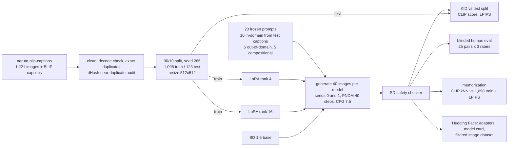

# Part 2 - Fine-Tuning Stable Diffusion for Naruto-Style Image Generation (member: Anushka)

This folder holds Anushka's complete Part 2 pipeline (tasks 2.1–2.4 of the lab):

* fine-tune Stable Diffusion 1.5 on `lambdalabs/naruto-blip-captions` with **two LoRA runs that differ only
  in rank (4 vs 16)**;
* generate a fixed prompt set with the base model and both runs;
* evaluate quality (KID), prompt alignment (CLIP score), diversity (LPIPS), a blinded human comparison,
  cost, NSFW safety and memorization.

Everything runs on one Colab T4 (16 GB).

## Folder layout

```
part2/member-anushka/
├── README.md                    this file
├── AI_USAGE.md                  how AI assistance was used in this pipeline and what Anushka built
├── failure_analysis.md          failure modes with examples, and the final-run choice (2.4.1)
├── requirements-p2.txt          pinned Colab environment (pip freeze of the training runtime + lpips)
├── eval/
│   ├── p2_fixed_20_prompts.json        the 20 evaluation prompts, frozen before training (2.3.1)
│   ├── part2_metrics.json              per model: KID ± std, CLIP and LPIPS (overall + by category), NSFW flags,
│   │                                   human win rate, training parameters / time / GPU-hours / peak memory
│   ├── part2_memorization.json         3 closest generated/training pairs, all 10 top-1 matches, calibration (C4)
│   ├── part2_data_and_decision.json    data cleaning counts and split (2.1); facts behind the final-run choice (2.4.1)
│   └── part2_human_eval/
│       ├── blind_pairs.json            the 25 blinded pairs with all 75 ratings
│       ├── answer_key.json             which model was shown on each side
│       └── summary.json                raters, win rates per rater / category, agreement, Fleiss' kappa, position bias
├── notebooks/
│   ├── p2_finetune.ipynb        2.1 data preparation, 2.2 training, 2.3 generation   (executed)
│   └── p2_evaluate.ipynb        2.3 grids, 2.4 evaluation, safety, human eval, release (executed)
└── scripts/
    ├── p2_cells.py              source of every cell of p2_evaluate.ipynb
    └── build_p2_notebooks.py    rebuilds the notebooks from p2_cells.py
```

Not in Git (rule S.6.4): model weights, the prepared dataset, generated images and tokens. They live on
Google Drive (`MyDrive/Sem3/DATA266/Lab2/Part2`) and on Hugging Face (links below).

## Pipeline



## 2.1 Data preparation

`notebooks/p2_finetune.ipynb` (cells *4. Download and clean* and *5. Display examples*) and the data-audit cell of `p2_evaluate.ipynb`.

**Steps.**

* Loaded all 1,221 image–caption pairs.
* Checked every image by decoding it, and removed exact duplicates by content hash.
* **Removed: 0 corrupt, 0 duplicate.**
* Split 90/10 with `seed = 266`: **1,098 train / 123 test**. Test images are used only for KID, the
  in-domain prompts and the memorization calibration.
* Resized to 512×512 (center crop).

**Audit** (in the evaluation notebook):

* re-decoding every prepared file with truncated-image loading disabled gives 0 failures;
* a 64-bit difference hash (Hamming distance ≤ 5) finds **1 test image** with a near-duplicate in the
  training split, and 0 near-duplicate pairs inside the training split.

**Dataset description.** Single-style anime frames of Naruto characters, mostly close-up faces and upper
bodies, with short BLIP captions (8.93 words on average, 79.2% distinct).

**Limitations and biases.**

1. **Copyrighted single style.** Every image is from one franchise, so the model learns one IP-bound
   style and is for non-commercial research only.
2. **Weak, generic captions.** BLIP captions describe one or two people and rarely mention lighting,
   counts or interactions ("a man with a beard"). This limits prompt following for compositional prompts.
3. **Gender skew.** 58.8% of captions mention male terms vs 20.6% female terms.
4. **Near-duplicate frames.** Consecutive frames of the same scene can fall on both sides of the split.

The dataset card on the Hub states no licence.

## 2.2 Fine-tuning

`notebooks/p2_finetune.ipynb` (cells *7. Train LoRA rank 4*, *8. Train LoRA rank 16*, *9. Required training comparison table* and the peak-memory cell).

Both runs use the Diffusers example `examples/text_to_image/train_text_to_image_lora.py`, pinned to
commit `6dcb307d1249daa30de102570aeba6eb40ea351a`. Settings are identical except the rank:

| setting | LoRA rank 4 (run 1) | LoRA rank 16 (run 2, final) |
|---|---|---|
| adapted modules | UNet attention `to_q`, `to_k`, `to_v`, `to_out.0` (alpha = rank) | same |
| trainable parameters | 797,184 | 3,188,736 |
| learning rate / schedule | 1e-4, constant, no warm-up | same |
| steps | 1,500 | 1,500 |
| batch size | 1 × gradient accumulation 4 (effective 4) | same |
| optimizer / precision | 8-bit AdamW (bitsandbytes), fp16 mixed precision, gradient checkpointing | same |
| augmentation | center crop + random horizontal flip | same |
| seed | 266 | 266 |
| training time | 2,921 s = **0.812 GPU-hours** | 2,908 s = **0.808 GPU-hours** |
| peak GPU memory | **6.15 GiB** (6,301 MiB) | **6.17 GiB** (6,323 MiB) |

* Training time is the wall-clock time of each run on one T4.
* Peak memory was sampled with an `nvidia-smi` poller during two repeat runs with the same settings.
* Both adapters are pushed to Hugging Face. The final run has a model card that the evaluation notebook
  generates from the computed results.

## 2.3 Image generation

**Prompts.** `eval/p2_fixed_20_prompts.json` holds 20 prompts, frozen in the training notebook (cell *6. Create and freeze the 20 prompts*)
before training:

| category | prompts |
|---|---|
| in-domain (10) | held-out **test** captions, e.g. P01 "a woman with purple hair and a scarf around her neck", P07 "a man in a blue jacket and tie" |
| out-of-domain (5) | P11 watercolour mountain village, P12 realistic photo of a red fox in snow, P13 floating glass skyscraper, P14 bowl of tropical fruit, P15 impressionist train station |
| compositional (5) | P16 two characters in red and blue side by side, P17 ninja with green sword beside an orange fox, P18 three characters sitting/standing/jumping, P19 character riding a bird above a village, P20 two characters exchanging a scroll at a red gate at sunset |

**Sampling.**

* Base model, rank 4 and rank 16 all use `PNDMScheduler`, 40 steps, guidance 7.5, seeds 0 and 1.
* This gives **40 images per model, 120 in total**, from the training notebook (cell *10. Generate base and LoRA images*).
* Generation ran with the safety checker disabled; the checker is applied to the saved images afterwards
  (see Safety).

**Grids and dataset.**

* Side-by-side grids for 8 prompts (P01, P03, P07, P08, P12, P14, P16, P18), base | rank 4 | rank 16,
  both seeds: grid cell of `p2_evaluate.ipynb`.
* Every image that passes the safety filter is published as a Hugging Face `imagefolder` dataset. Its
  root `metadata.csv` has the columns `file_name`, `model`, `prompt_id`, `category`, `prompt`, `seed`,
  `steps`, `guidance_scale` and `scheduler`.

## 2.4 Evaluation, safety and documentation

`notebooks/p2_evaluate.ipynb`, run with *Restart and run all* on a Colab T4.

| measurement | definition used |
|---|---|
| Primary: KID | `torchmetrics` KID on torch-fidelity Inception-v3 features. The 20 in-domain generations of each model are compared with all 123 test images, using 100 subsets of size 10 and reported as mean ± std over subsets. Real features are extracted once; subset sampling is seeded. |
| Primary: CLIP score | OpenCLIP ViT-B/32 (`openai` weights): cosine similarity of prompt and image embeddings, averaged per model and per prompt category |
| Secondary: diversity | LPIPS (AlexNet) between the seed-0 and seed-1 image of each prompt, averaged over the 20 prompts |
| Human evaluation | 25 unique blinded pairs (final run vs base, same prompt and seed, left/right randomized with a seeded RNG), 3 raters: Anushka, Nikhil and Ayush (outside the team). Each picks left / right / tie for *domain style and prompt match*. Reported: win rate excluding ties, per rater, pooled and per category; pairwise agreement; Fleiss' κ; a two-sided binomial test of each rater's left/right choices. |
| Efficiency | GPU-hours per training run, plus peak GPU memory |

### Results

From the results-table cell of `p2_evaluate.ipynb`; the same values are in `eval/part2_metrics.json`.

| model | KID in-domain ↓ | CLIP (20 prompts) | CLIP (in-domain) | LPIPS diversity | human win rate vs base | NSFW flagged / 40 | GPU-hours | peak GPU memory |
|---|---|---|---|---|---|---|---|---|
| base | 0.1420 ± 0.0260 | 0.3126 | 0.2953 | 0.6902 | reference | 0 | - | - |
| LoRA r4 | 0.0336 ± 0.0155 | 0.3067 | 0.2885 | 0.6924 | not rated | 2 | 0.812 | 6.15 GiB |
| **LoRA r16 (final)** | **0.0351 ± 0.0162** | 0.3037 | 0.2865 | 0.6761 | **42.6%** | **0** | 0.808 | 6.17 GiB |

**What worked.**

* Both adapters reduce in-domain KID by about 75% compared with the base model (0.142 → 0.034 / 0.035).
* Each costs under one GPU-hour and about 6 GiB on a T4.

**What did not work.**

* Prompt alignment does not improve. CLIP is slightly lower than the base model in every category
  except out-of-domain.
* Raters preferred the final run only on out-of-domain prompts (72.7%). On in-domain prompts they
  preferred the base model (final-run win rate 28.0%).
* Human agreement is low (Fleiss' κ = 0.086), and two raters show a significant left/right preference,
  so the human result is weak evidence.

### Failure modes and final-run choice (2.4.1)

See [`failure_analysis.md`](failure_analysis.md). The failure-mode figure is drawn and embedded by the
failure-mode cell of `p2_evaluate.ipynb`.

* **Final run: LoRA rank 16.** Rank 4 and rank 16 are indistinguishable on KID (gap 0.0015 vs subset
  std 0.016), CLIP and cost.
* Rank 16 is the only run with no NSFW-flagged outputs on the fixed prompts; rank 4 had 2 false
  positives on harmless prompts.

### Safety (C4)

* **Licence.**
  * Naruto characters are copyrighted, so the adapters and generated images are for non-commercial
    research and teaching only.
  * SD 1.5 is licensed under CreativeML OpenRAIL-M, and its use restrictions carry over to the adapters.
  * The dataset card states no licence.
* **NSFW filter.**
  * The Stable Diffusion safety checker, with the pipeline's own CLIP feature extractor, is applied to
    all 120 images.
  * Flagged: base 0, rank 4 2 (P04 seed 0, P06 seed 0, both harmless prompts), rank 16 0.
  * Flagged images are excluded from the released dataset and were deleted from the first, unfiltered
    upload.
* **Memorization.**
  * The 10 in-domain generations of rank 16 are compared with all 1,098 training images by CLIP
    similarity, and the 3 closest pairs are shown with LPIPS.
  * Highest similarity: 0.928. This is below the 95th percentile of real held-out frames vs the training
    set (0.943), with 0 of 10 generations above it.
  * Smallest LPIPS to a training image: 0.553.
  * The base model, as a control, averages 0.610 top-1 similarity vs 0.810 for rank 16. The adapter
    copies the *style*, not specific frames.

## How to run

1. **Colab set-up.**
   * *Runtime → Change runtime type → T4 GPU*.
   * Add the Colab secret `HF_TOKEN` (Hugging Face token with write access) and enable notebook access.
   * The notebooks mount Google Drive and use `MyDrive/Sem3/DATA266/Lab2/Part2` as the project folder.
     To use another folder, set the environment variable `P2_PROJECT_DIR`.
2. **`notebooks/p2_finetune.ipynb`.**
   * Installs the pinned stack, clones Diffusers at the pinned commit and installs `bitsandbytes`.
   * Prepares and splits the data, freezes the prompts, trains both runs, measures peak memory and
     generates 3 × 40 images.
   * Pushes both adapters to Hugging Face.
   * Steps whose outputs already exist on Drive are skipped. The committed notebook keeps the outputs of
     the original training runs.
3. **`notebooks/p2_evaluate.ipynb`, *Restart and run all* (about 20 min on a T4).** It runs:
   * the data audit;
   * the comparison grids;
   * CLIP / LPIPS / KID;
   * the NSFW filter;
   * the human-evaluation sheets and statistics (ratings in `eval/part2_human_eval/blind_pairs.json`);
   * the memorization check;
   * the failure-mode figure;
   * the results table and decision;
   * the model card;
   * the dataset release.

   `UPLOAD_TO_HUB = True` publishes the model cards and the filtered dataset. `CLEAN_UNFILTERED_REPO =
   True` removes flagged images from the first upload.
4. **Cell 1** of each notebook prints the Git commit, library versions, GPU and seed (C1.4).
   `COMMIT_HASH` holds the short hash of the commit the notebook was run from.
   In `p2_finetune.ipynb`, the required Cell 1 was added after training had finished and was run on its own
   (commit `c167af8`), so it is the only cell with an execution count. Every other cell keeps the outputs of the
   original Colab training run, unchanged; training was not repeated.

Environment: `requirements-p2.txt`. Key library versions printed by Cell 1 of the evaluation run:

| package | version |
|---|---|
| torch | 2.14.1+cu130 |
| diffusers | 0.42.0.dev0, source at commit `6dcb307d` |
| transformers | 5.22.1 |
| peft | 0.21.2 |
| accelerate | 1.15.0 |
| open_clip_torch | 3.3.0 |
| lpips | 0.1.4 |
| torchmetrics | 1.9.0 |
| torch-fidelity | 0.4.0 |
| huggingface_hub | 1.33.0 |

## Hugging Face artifacts

| what | link |
|---|---|
| LoRA rank 4 (run 1) | https://huggingface.co/Anushka1202/data266-lab2-part2-lora-rank4 |
| LoRA rank 16 (run 2, final) + model card | https://huggingface.co/Anushka1202/data266-lab2-part2-lora-rank16 |
| generated images, safety-filtered, with prompt / seed / model metadata | https://huggingface.co/datasets/Anushka1202/data266-lab2-part2-generated-images-safe |

```python
import torch
from diffusers import StableDiffusionPipeline

pipe = StableDiffusionPipeline.from_pretrained("stable-diffusion-v1-5/stable-diffusion-v1-5",
                                               torch_dtype=torch.float16).to("cuda")
pipe.load_lora_weights("Anushka1202/data266-lab2-part2-lora-rank16")
image = pipe("a man with pink hair and a hat", num_inference_steps=40, guidance_scale=7.5,
             generator=torch.Generator("cuda").manual_seed(0)).images[0]
```

## References

* Rombach et al., 2022. *High-Resolution Image Synthesis with Latent Diffusion Models.* arXiv:2112.10752
* Hu et al., 2021. *LoRA: Low-Rank Adaptation of Large Language Models.* arXiv:2106.09685
* Carlini et al., 2023. *Extracting Training Data from Diffusion Models.* arXiv:2301.13188
